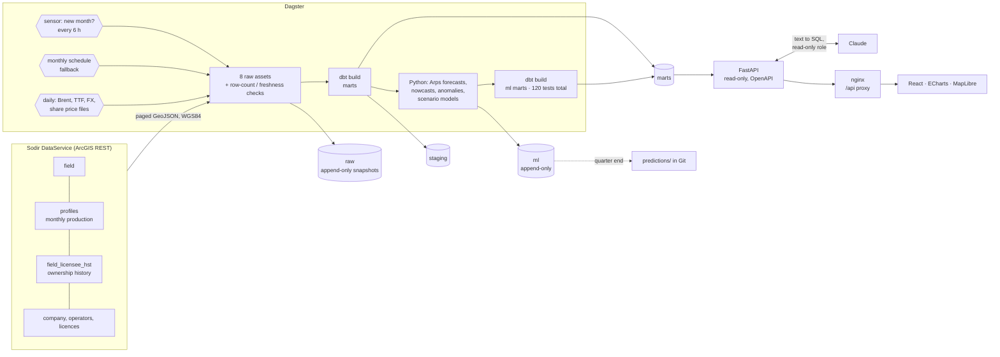
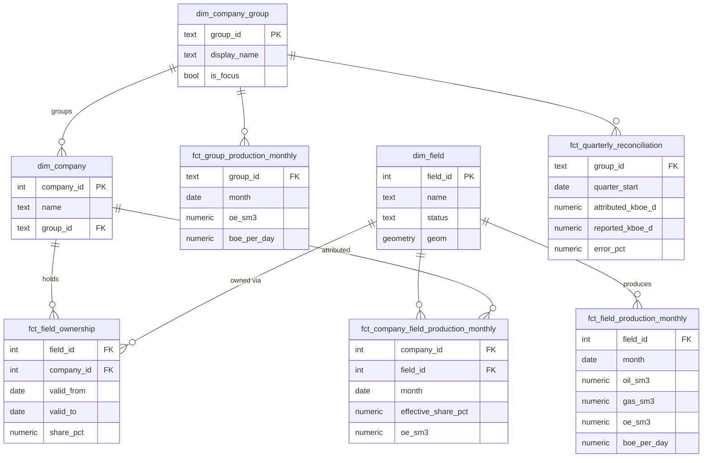

# Stakeflow

[](https://github.com/plohospalqq/stakeflow/actions/workflows/ci.yml)
[](https://plohospalqq.github.io/stakeflow/)


[](https://data.norge.no/nlod/en/2.0)
[](LICENSE)

**Who produces what on the Norwegian shelf.** Stakeflow takes the monthly field production that
[Sodir](https://www.sodir.no/en/) (the Norwegian Offshore Directorate) publishes, joins it to who
owned each field on each day, and answers a question no public table answers directly: **how much
did each company produce, month by month?**


**[Open the live demo →](https://plohospalqq.github.io/stakeflow/)** · [dbt docs and lineage graph](https://plohospalqq.github.io/stakeflow/dbt/) · [API reference](api/openapi.json)

The demo is a static snapshot of the real API, rebuilt from live Sodir data on every push; it
needs no backend. Run the full stack locally for live data (see Quick start).

Built end to end as a data / ML engineering portfolio project: ingestion, orchestration, a tested
dbt warehouse, a typed API and a web app, plus field forecasts, quarterly nowcasts with a public
prediction log, anomaly detection, a share-price scenario model and a text-to-SQL agent, all
served by the API and shown in the app.

## Results so far

Production attributed from public Sodir data reconciles with what the companies themselves
report, closely: within 1% for Aker BP and Equinor's Norway segment, over 14 complete quarters:

| Company | Complete quarters compared | Mean absolute gap | Bias |
|---|---:|---:|---:|
| Equinor (E&P Norway segment) | 14 | 0.22% | +0.15% |
| Aker BP | 14 | 0.72% | −0.72% |
| Vår Energi | 14 | 3.8% | −3.8% |

Example: Aker BP Q2 2026, 380.8 kboe/d from Sodir vs 383.6 reported (−0.74%).

Reported figures come from the companies' trading updates (sources in
[`reported_quarterly_production.csv`](pipeline/dbt/seeds/reported_quarterly_production.csv)).
Vår Energi's figures include fuel gas it burns rather than sells, so they run above Sodir's
saleable volumes; its Q1 2024 gap (−10%) is the Neptune acquisition, which the company counted
from 1 January while the licence transfer is dated 31 January. Field volumes match Sodir's own
published numbers exactly (checked against the live Sodir API, and by a dbt test for every field
and month).

**Forecasts.** Quarterly production nowcasts (Arps decline per field × ownership), replayed for
45 past quarters using only data Sodir had published by each quarter end, scored against the
first figure each company published and against the simple guess "same as last quarter":

| Company | Model error | Simple guess | Comment |
|---|---:|---:|---|
| Aker BP | **2.6%** | 3.5% | model better |
| Equinor (E&P Norway) | **3.6%** | 4.7% | model better |
| Vår Energi | 9.1% | 8.1% | worse: new fields (Balder X, Johan Castberg) are invisible to a decline model until they produce |

The 80% ranges hold the actual figure 62% of the time, so they are too narrow, and the app says
so. Live predictions are frozen at each quarter end and committed to `predictions/`
by a GitHub Action ([freeze-predictions.yml](.github/workflows/freeze-predictions.yml)); the first one (Q4 2026) is scored when the January trading updates appear.

## What you can do in the app

| | |
|---|---|
| **Company detail.** Net production by field with day-weighted ownership, Sodir vs reported by quarter, a revenue estimate with the formula visible.  | **Field detail.** History by product, the full ownership timeline (e.g. Lundin → Aker BP, 30 Jun 2022), facts and a CSV export.  |
| **Field map.** Every field on MapLibre: size = production, colour = oil vs gas, highlight a company's fields, keyboard-accessible list.  | **Track record.** The Sodir-vs-reported comparison, and every quarterly nowcast scored against the company's report and a simple guess, live predictions and backtests kept apart.  |

Also: a **landing page** that explains the shelf in plain words, a **Scenarios** page (what a
share price might do if oil, gas, production or the dollar moved: a transparent OLS model with
its fit and uncertainty, never a forecast), **anomalies** (months a field produced far off its
own trend), **English, Ukrainian and Norwegian**, and a **Simple words / Expert** switch.
Dark and light themes, boe/d or Sm³ o.e., and a phone layout with a bottom tab bar
([all screenshots](frontend/docs/screenshots/)). With the local stack every number is live. The
public demo carries the real forecasts, nowcasts, prediction log, anomalies and prices; share
prices and the scenario model (Euronext data, which may not be redistributed) and Ask stay
badged **Sample data** there ([details](frontend/README.md#real-data-and-sample-data)).

## Ask the data (Claude)

`POST /ask` turns a question into one read-only SQL query over the marts with Claude, runs it and
answers in plain language; `POST /scenarios/parse` turns a free-text case ("What if Johan
Sverdrup stops for two months?") into scenario parameters. Guardrails, in layers:

1. the model's SQL is parsed with sqlglot: exactly one SELECT, only `marts.*`/`ml.*` tables
   (CTE names resolved per scope), an allow-list of functions, re-rendered before it runs;
2. it runs as `stakeflow_reader`: SELECT on marts/ml only, read-only transactions, 3 s timeout,
   500-row cap;
3. every number in the answer must trace back to a cell of the result;
4. the scenario parser only extracts what the text says; the arithmetic is code over the data.

An eval set (39 questions incl. refusals and a prompt injection, 11 scenario cases) scores result
equivalence and safety: `make eval` with `ANTHROPIC_API_KEY` set. Without a key both endpoints
answer 503: Ask then answers with prepared examples and says why, and the scenario explorer says
AI is not configured and points to its sliders and presets.

## Scope

- **In scope:** NCS production per field and per company, revenue estimates, forecast accuracy.
- **NCS only:** company figures cover the Norwegian shelf only. Equinor is always shown as
  "Equinor (NCS only)" and is never compared with its group totals.
- **Not in scope:** stock price predictions. Share prices appear for context, and a what-if
  scenario explorer shows modelled sensitivity to assumptions you choose, never a forecast.
- Not investment advice.

## Quick start

Requirements: Docker (with Compose) and `make`.

```bash
git clone https://github.com/plohospalqq/stakeflow.git && cd stakeflow
make up        # writes .env with a random DB password, builds and starts everything
```

On first start the Dagster sensor sees Sodir's newest month and runs the whole pipeline by itself.
From an empty database to a working app takes about two minutes.

| What | Where |
|---|---|
| Web app | http://localhost:3002 |
| API docs (OpenAPI) | http://localhost:8000/docs |
| Dagster UI (asset graph, runs, checks) | http://localhost:3000 |
| Postgres | `make psql` (localhost:5433) |

All ports bind to 127.0.0.1 only. `make down` stops everything and keeps the data.

## Architecture



Everything runs in Docker: Postgres 17 + PostGIS, the Dagster webserver and daemon, the API and
the web app (static build behind an unprivileged nginx that also proxies `/api`, so the browser
only ever talks to one origin). Dagster keeps its run history in a separate `dagster` database.

### Data model (marts)



Plus `fct_publication_lag` (how late Sodir publishes, measured from our own snapshots) and
`meta_data_freshness` (the "Sodir · through Aug 2026" badge).

### How a month of production gets to a company

1. **Field volume.** Sodir gives net (saleable) oil, NGL and condensate in million Sm³ and gas
   in billion Sm³. Staging converts everything to Sm³; oil equivalent is
   `oil + NGL + condensate + gas / 1000`, which reproduces Sodir's own o.e. column for every
   field and month (a dbt test checks this).
2. **Ownership on each day.** `fct_field_ownership` is an SCD Type 2 table: one row per field,
   company and period, `valid_to` exclusive. Field-level shares are used, not licence shares,
   because unitised fields span several licences.
3. **Day-weighted share.** Deals close mid-month. On 30 June 2022 Lundin's 20% of Johan Sverdrup
   moved to Aker BP's ABP Norway AS; for June that gives Lundin 20% × 29/30 and ABP Norway
   20% × 1/30.
4. **Attribution.** company volume = field volume × effective share; boe/d = Sm³ o.e. × 6.2898 ÷
   days in month.

## Development

```bash
make help      # every command
make web       # frontend dev server with hot reload on :5173 (uses the API from make up)
make refresh   # queue a full refresh (all Sodir layers + dbt) in the running Dagster
make ingest    # without Dagster: download Sodir layers into raw.*
make dbt       # without Dagster: dbt build (models + tests)
make test      # pipeline + API pytest, frontend vitest
make lint      # ruff, eslint, prettier, tsc
make openapi   # regenerate api/openapi.json (the frontend's typed contract)
```

Local development also needs [uv](https://docs.astral.sh/uv/) and [pnpm](https://pnpm.io/).
Frontend details: [`frontend/README.md`](frontend/README.md).

## Testing

| Layer | What is tested |
|---|---|
| Sodir client | Paging, offsets, HTML and `{"error"}` responses with HTTP 200, endless-loop guard; recorded real responses, no network |
| Raw store | Append-only snapshots, all-or-nothing load when the row count does not match Sodir |
| Dagster | Code location loads; dbt models sit downstream of the raw assets; row-drop and freshness checks |
| dbt (120 tests) | o.e. matches Sodir for every field-month; attributed volumes sum back to field volumes; shares cover 100% while a field is owned; no overlapping ownership intervals; valid geometries; "Equinor (NCS only)" label; keys and relationships |
| Pipeline (139 tests) | Arps fit recovers known parameters; interval coverage on synthetic data; prediction hashes are deterministic and rows append-only; anomaly rule; OLS recovers known coefficients; market and Euronext parsers on recorded files |
| API (423 tests) | Products add up to o.e.; boe/d formula; 404/422 on bad input; literal search; reconciliation; ownership history; GeoJSON; caching/304; the SQL guard (DDL, multi-statement, CTE scoping, function allow-list) and the read-only role; scenario contract and clamping; Ask and parsing against a mocked Claude |
| Frontend (228 tests) | Unit maths (boe/d, Sm³), components, every route rendering on mocked data, the live-API mappers on real response shapes, which data is sample in which mode, URL safety, Ask answers never dead-end and only use real tables |
| Live demo | `pages.yml` builds the warehouse from live Sodir data (offline snapshot as fallback), runs every dbt test, exports the API's responses and deploys the app plus dbt docs to GitHub Pages |
| CI | All of the above on every push: lint and tests per project; the warehouse job builds the full dbt project from a 385 KiB offline Sodir snapshot in a PostGIS service; OpenAPI and generated TypeScript types must match; Docker images build |

Before release the stack was also tested by hand from an empty database (`make reset && make up`),
in a browser on every route (dark/light, 1440 px and 390 px, console clean, no horizontal
overflow), with negative API tests (bad parameters, SQL-injection attempts: only 404/422, never
500) and a spot check of field volumes against the live Sodir API (exact match).

## Design decisions

| Decision | Why |
|---|---|
| Sodir DataService REST API, not FactPages CSV downloads | Sodir is phasing out the downloads. The API exposes every table with paging and a count we can verify each load against. |
| Raw layer keeps every snapshot (`ingestion_run_id`), one transaction per layer | Sodir revises history. Snapshots let later forecasts be backtested on what was known at the time (no look-ahead bias). A partial snapshot would be worse than none, so a load is all or nothing. |
| Sensor on "new month?" plus a monthly schedule | One tiny query every 6 hours starts the pipeline as soon as Sodir publishes and measures the publication lag to the day. The schedule catches silent revisions. |
| Field-level ownership, day-weighted within the month | Unitised fields span licences; deals close mid-month. Month-end shares would misattribute volumes. |
| Curated company groups (dbt seed), static legal-entity mapping | Sodir's own `cmpGroup` is inconsistent (typos, trailing spaces). On the shelf, M&A moves shares to new legal entities, so a static map keeps history right: Lundin stays Lundin until 2022, then ABP Norway counts as Aker BP. |
| Net (saleable) volumes | What companies report, so results can be checked against their numbers. |
| Postgres + PostGIS, not a separate warehouse | The data is small (about 80k rows per snapshot). One database keeps the stack simple; PostGIS repairs and serves the field polygons. |
| dbt for transformations, tests as Dagster asset checks | SQL stays reviewable and versioned; a failing data test shows up next to the asset it protects. |
| Read-only API sessions (`default_transaction_read_only`) | The API cannot change the warehouse, even with a bug. |
| OpenAPI snapshot committed, frontend types generated from it | The API/UI contract is checked in CI; drift fails the build. |
| Real API where it exists, badged sample data elsewhere | The UI for later phases can be built and reviewed now, without ever passing a sample number off as real. |
| Same-origin `/api` behind nginx | No CORS in production, one origin to secure; the Vite dev proxy mirrors it. |
| Static snapshot demo on Pages, same mappers as the live API | Recruiters can click through without Docker, and the demo cannot drift from the API's types. |
| Strict CSP, no inline scripts | `script-src 'self'`; only the map tile host is allowed out. Charts need inline style attributes only. |
| Cache-Control + freshness ETag | Data changes monthly; browsers revalidate cheaply and get 304s until Sodir publishes. |
| Untrusted URLs filtered twice | Links from third-party data are rendered only if https to a known host (frontend) and Sodir URLs are validated again in dbt staging. |
| Forecast in Python, scoring in dbt, predictions append-only by trigger | Curve fitting needs scipy; scoring is plain SQL that should be reviewable. A database trigger, not a convention, keeps the prediction log honest; the Git commit is the public timestamp. |
| Scenario model instead of share-price prediction | A transparent OLS on monthly returns shows sensitivity with its fit and uncertainty; an LLM may only turn free text into the model's inputs, never produce numbers. |
| Share prices only from the user's own Euronext download | Euronext forbids robots and redistribution, so the pipeline never downloads them, and the public demo never contains them. |
| Typed i18n dictionaries, no library | Three languages; a missing key is a compile error; plurals and numbers via `Intl`. |
| Nowcast reframed (see [docs/nowcast-feasibility.md](docs/nowcast-feasibility.md)) | Companies publish production 12–14 days after quarter end; Sodir field data lands 40–69 days after month end. Forecasts are therefore frozen at quarter end and scored against the trading update. |

## Repository layout

```
pipeline/   Dagster + dbt: Sodir and market loaders, raw snapshots, sensor, dbt models, seeds,
            forecasts (Arps, nowcasts), anomalies, scenario models, tests
api/        FastAPI (read-only on marts), Ask/scenario parsing with Claude, evals, OpenAPI contract
frontend/   React + TypeScript + Vite + Tailwind + ECharts + MapLibre, nginx image
infra/      Postgres image (PostGIS) and init SQL
docs/       plans, nowcast feasibility, forecasting method, market data sources and licences
predictions/ quarter-end predictions committed by the freeze workflow (never edited by hand)
```

## Roadmap

Done: Phase 1 (pipeline, warehouse, API, app) and Phase 2 (forecasts, nowcasts, prediction log,
prices, anomalies, scenario model, Ask, three languages, live demo). Next:

- Calibrate the forecast ranges (80% nominal, about 62% actual) and detect fields that are about
  to start producing.
- Score the first live prediction (Q4 2026) against the January trading updates.
- Run the Ask evaluation set against Claude once an API key is configured (`make eval`).

## Data licence

Contains data under the [Norwegian Licence for Open Government Data (NLOD)](https://data.norge.no/nlod/en/2.0)
made available by Sodir. Brent prices: U.S. Energy Information Administration (public domain).
Exchange rates: European Central Bank. European gas (TTF) prices: World Bank Commodity Price Data
(Pink Sheet), CC BY 4.0. Share prices are never redistributed: you download them yourself for
local use (see [docs/market-data-sources.md](docs/market-data-sources.md)). Code under the [MIT licence](LICENSE). Not investment advice.

This is a personal project.
