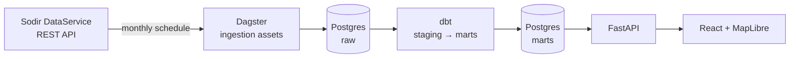

# Stakeflow

Norwegian Continental Shelf production intelligence: monthly field production from
[Sodir](https://www.sodir.no/en/) (the Norwegian Offshore Directorate), attributed to the
companies that own each field, over time.

> **Status:** Phase 1 in progress. See [`docs/phase-1-plan.md`](docs/phase-1-plan.md).
> Sections below describe the target design; anything not built yet is marked *planned*.

## Architecture



## Setup

Requirements: Docker, `make`.

```bash
make env               # .env with a random DB password
make up                # Postgres + PostGIS
make psql              # check it works
```

Pipeline, API and frontend setup: *planned* (Phase 1 steps 1–7).

## Design decisions

| Decision | Why |
|---|---|
| Sodir DataService REST API, not FactPages CSV downloads | Sodir is phasing out the old downloads; the API gives every table with paging and row counts we can check against |
| Raw layer stores every snapshot (`ingestion_run_id`) | Sodir revises history. Keeping snapshots lets later forecasts be backtested on what was known at the time |
| Field-level ownership (`field_licensee_hst`), not licence-level | Fields can span several licences (unitisation); the field share is the economically correct split |
| Shares day-weighted within a month | Ownership deals close mid-month; month-end shares would misattribute volumes |
| Net (saleable) volumes | Matches what companies report, so results are comparable to annual reports |
| PostGIS | Field polygons are real geometry; spatial queries come for free |

## Data licence

Contains data under the [Norwegian Licence for Open Government Data (NLOD)](https://data.norge.no/nlod/en/2.0)
made available by Sodir.
