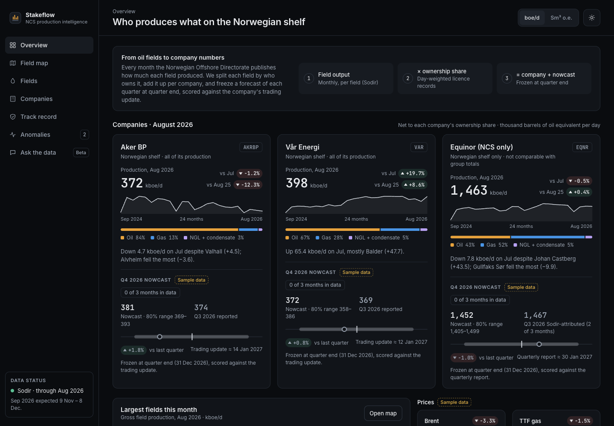
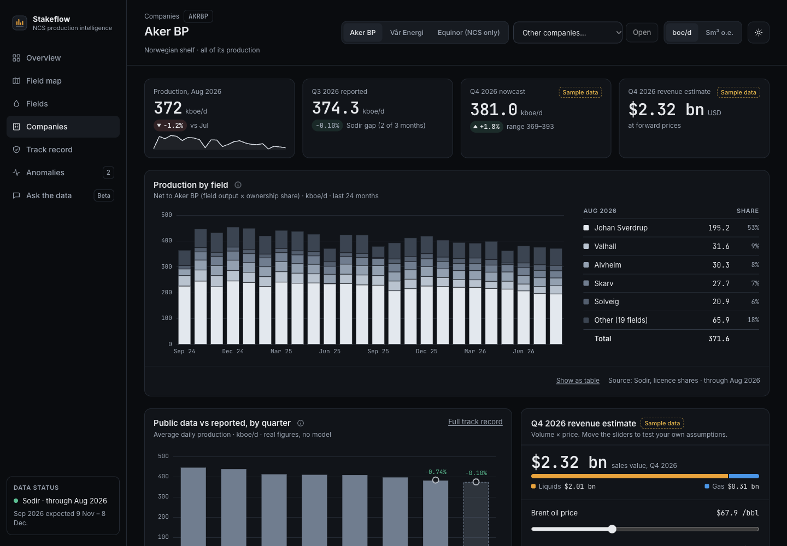
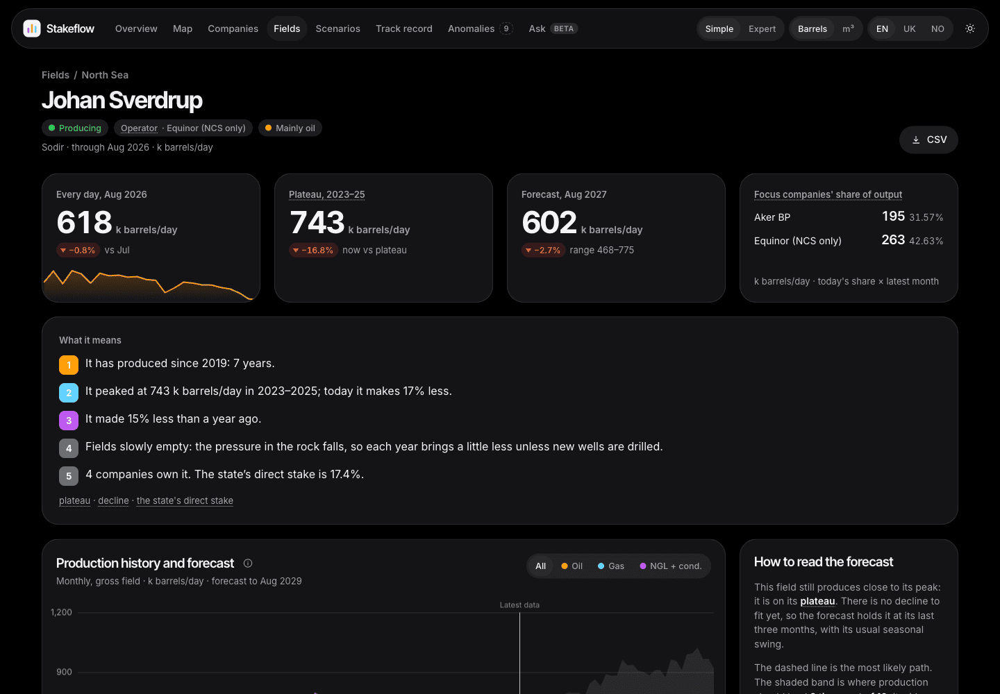
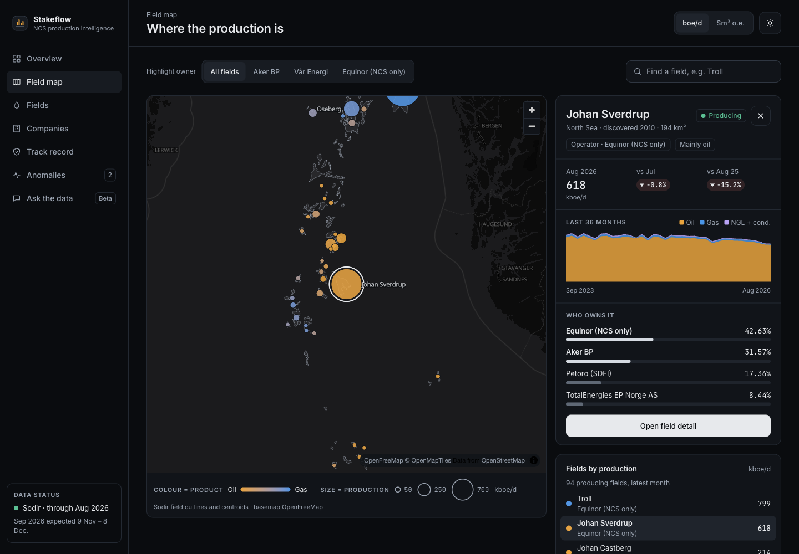
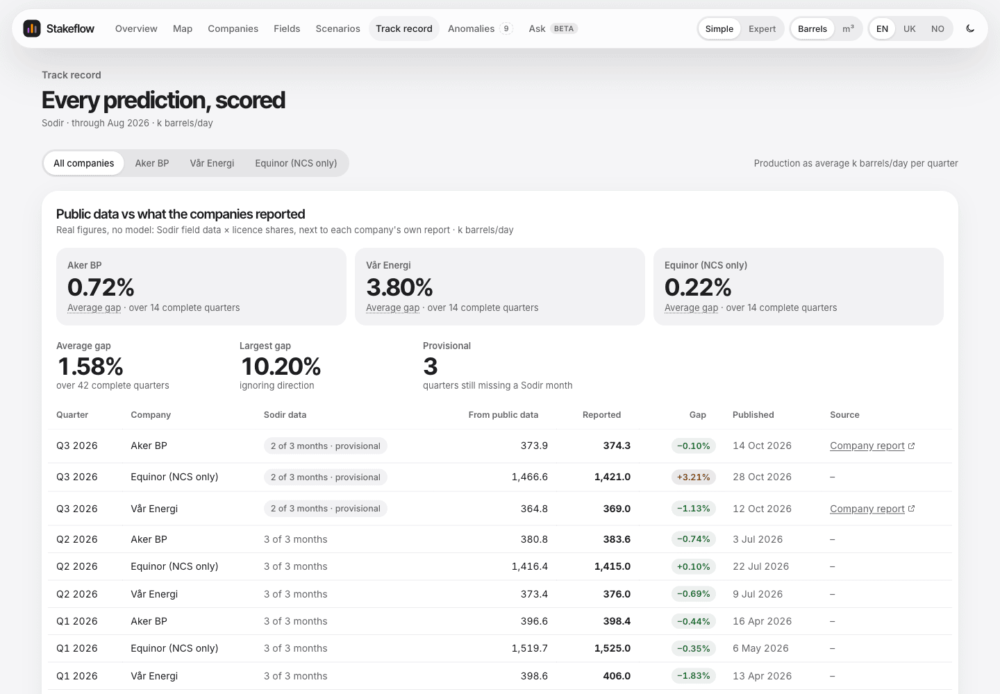
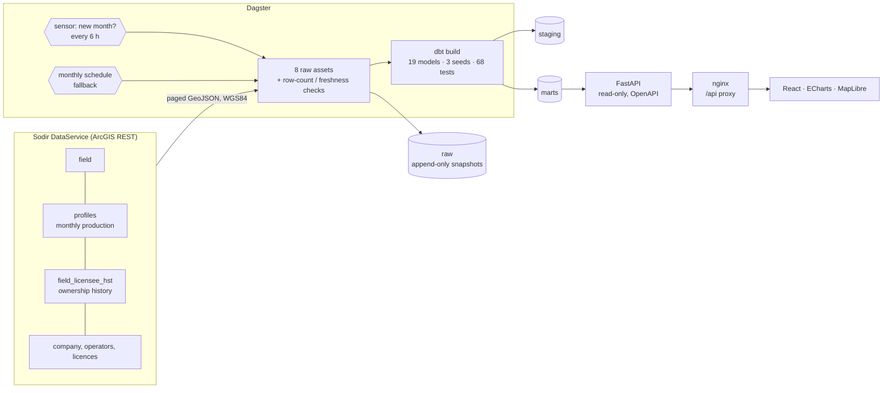
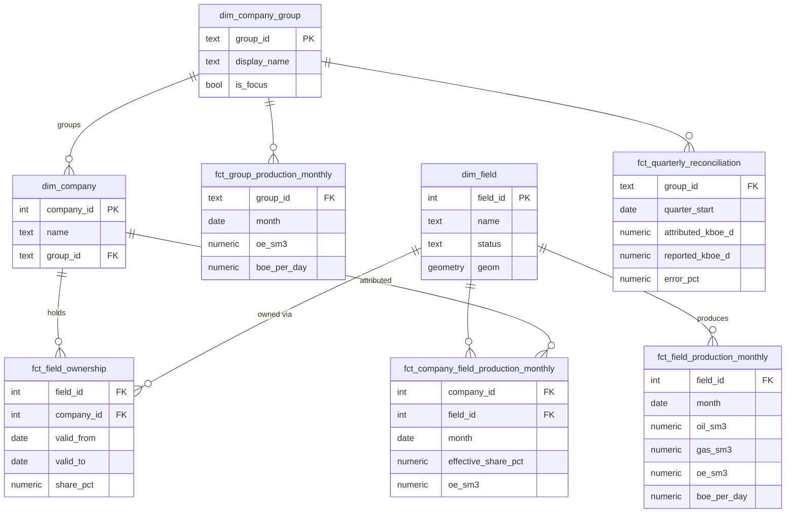

# Stakeflow

[](https://github.com/plohospalqq/stakeflow/actions/workflows/ci.yml)


[](https://data.norge.no/nlod/en/2.0)
[](LICENSE)

**Who produces what on the Norwegian shelf.** Stakeflow takes the monthly field production that
[Sodir](https://www.sodir.no/en/) (the Norwegian Offshore Directorate) publishes, joins it to who
owned each field on each day, and answers a question no public table answers directly: **how much
did each company produce, month by month?**



Built end to end as a data / ML engineering portfolio project: ingestion, orchestration, a tested
dbt warehouse, a typed API and a web app. The later phases (forecasts, nowcasts, anomaly
detection, a text-to-SQL agent) are designed in from the start and already have a UI preview.

## Results so far

Production attributed from public Sodir data reconciles with what the companies themselves
report, to within about 1%:

| Company | Quarter | Stakeflow (Sodir-attributed) | Company-reported | Gap |
|---|---|---:|---:|---:|
| Aker BP | Q2 2026 | 380.8 kboe/d | 383.6 kboe/d | −0.74% |
| Vår Energi | Q2 2026 | 373.4 kboe/d | 376 kboe/d | −0.69% |
| Vår Energi | Q3 2025 | 362.2 kboe/d | 370 kboe/d | −2.10% |

Reported figures come from the companies' trading updates (sources in
[`reported_quarterly_production.csv`](pipeline/dbt/seeds/reported_quarterly_production.csv)).
The remaining gap is expected: companies report entitlement volumes and use their own boe
conversion. Field volumes match Sodir's own published numbers exactly (checked against the live
Sodir API, and by a dbt test for every field and month).

## What you can do in the app

| | |
|---|---|
| **Company detail.** Net production by field with day-weighted ownership, Sodir vs reported by quarter, a revenue estimate with the formula visible.  | **Field detail.** History by product, the full ownership timeline (e.g. Lundin → Aker BP, 30 Jun 2022), facts and a CSV export.  |
| **Field map.** Every field on MapLibre: size = production, colour = oil vs gas, highlight a company's fields, keyboard-accessible list.  | **Track record.** The real Sodir-vs-reported comparison today, and the scoring frame (frozen at quarter end, baseline, public hash) the forecasts will use.  |

Dark and light themes, boe/d or Sm³ o.e., and a phone layout with a bottom tab bar
([all screenshots](frontend/docs/screenshots/)). Forecasts, nowcasts, anomalies, prices and Ask
answers are a preview: every element showing them carries a **Sample data** badge
([details](frontend/README.md#real-data-and-sample-data)).

## Scope

- **In scope:** NCS production per field and per company, revenue estimates, forecast accuracy.
- **NCS only:** company figures cover the Norwegian shelf only. Equinor is always shown as
  "Equinor (NCS only)" and is never compared with its group totals.
- **Not in scope:** stock price predictions. Share prices appear for context, and a what-if
  scenario explorer shows modelled sensitivity to assumptions you choose, never a forecast.
- Not investment advice.

## Quick start

Requirements: Docker (with Compose) and `make`.

```bash
git clone https://github.com/plohospalqq/stakeflow.git && cd stakeflow
make up        # writes .env with a random DB password, builds and starts everything
```

On first start the Dagster sensor sees Sodir's newest month and runs the whole pipeline by itself.
From an empty database to a working app takes about two minutes.

| What | Where |
|---|---|
| Web app | http://localhost:3002 |
| API docs (OpenAPI) | http://localhost:8000/docs |
| Dagster UI (asset graph, runs, checks) | http://localhost:3000 |
| Postgres | `make psql` (localhost:5433) |

All ports bind to 127.0.0.1 only. `make down` stops everything and keeps the data.

## Architecture



Everything runs in Docker: Postgres 17 + PostGIS, the Dagster webserver and daemon, the API and
the web app (static build behind an unprivileged nginx that also proxies `/api`, so the browser
only ever talks to one origin). Dagster keeps its run history in a separate `dagster` database.

### Data model (marts)



Plus `fct_publication_lag` (how late Sodir publishes, measured from our own snapshots) and
`meta_data_freshness` (the "Sodir · through Aug 2026" badge).

### How a month of production gets to a company

1. **Field volume.** Sodir gives net (saleable) oil, NGL and condensate in million Sm³ and gas
   in billion Sm³. Staging converts everything to Sm³; oil equivalent is
   `oil + NGL + condensate + gas / 1000`, which reproduces Sodir's own o.e. column for every
   field and month (a dbt test checks this).
2. **Ownership on each day.** `fct_field_ownership` is an SCD Type 2 table: one row per field,
   company and period, `valid_to` exclusive. Field-level shares are used, not licence shares,
   because unitised fields span several licences.
3. **Day-weighted share.** Deals close mid-month. On 30 June 2022 Lundin's 20% of Johan Sverdrup
   moved to Aker BP's ABP Norway AS; for June that gives Lundin 20% × 29/30 and ABP Norway
   20% × 1/30.
4. **Attribution.** company volume = field volume × effective share; boe/d = Sm³ o.e. × 6.2898 ÷
   days in month.

## Development

```bash
make help      # every command
make web       # frontend dev server with hot reload on :5173 (uses the API from make up)
make refresh   # queue a full refresh (all Sodir layers + dbt) in the running Dagster
make ingest    # without Dagster: download Sodir layers into raw.*
make dbt       # without Dagster: dbt build (models + tests)
make test      # pipeline + API pytest, frontend vitest
make lint      # ruff, eslint, prettier, tsc
make openapi   # regenerate api/openapi.json (the frontend's typed contract)
```

Local development also needs [uv](https://docs.astral.sh/uv/) and [pnpm](https://pnpm.io/).
Frontend details: [`frontend/README.md`](frontend/README.md).

## Testing

| Layer | What is tested |
|---|---|
| Sodir client | Paging, offsets, HTML and `{"error"}` responses with HTTP 200, endless-loop guard; recorded real responses, no network |
| Raw store | Append-only snapshots, all-or-nothing load when the row count does not match Sodir |
| Dagster | Code location loads; dbt models sit downstream of the raw assets; row-drop and freshness checks |
| dbt (68 tests) | o.e. matches Sodir for every field-month; attributed volumes sum back to field volumes; shares cover 100% while a field is owned; no overlapping ownership intervals; valid geometries; "Equinor (NCS only)" label; keys and relationships |
| API | Products add up to o.e.; boe/d formula; 404/422 on bad input; literal (non-wildcard) search; reconciliation; ownership history; GeoJSON |
| Frontend (109 tests) | Unit maths (boe/d, Sm³), components, every route rendering on mocked data, URL safety, Ask answers never dead-end and only use real tables |
| CI | All of the above on every push: lint and tests per project; the warehouse job builds the full dbt project from a 385 KiB offline Sodir snapshot in a PostGIS service; OpenAPI and generated TypeScript types must match; Docker images build |

Before release the stack was also tested by hand from an empty database (`make reset && make up`),
in a browser on every route (dark/light, 1440 px and 390 px, console clean, no horizontal
overflow), with negative API tests (bad parameters, SQL-injection attempts: only 404/422, never
500) and a spot check of field volumes against the live Sodir API (exact match).

## Design decisions

| Decision | Why |
|---|---|
| Sodir DataService REST API, not FactPages CSV downloads | Sodir is phasing out the downloads. The API exposes every table with paging and a count we can verify each load against. |
| Raw layer keeps every snapshot (`ingestion_run_id`), one transaction per layer | Sodir revises history. Snapshots let later forecasts be backtested on what was known at the time (no look-ahead bias). A partial snapshot would be worse than none, so a load is all or nothing. |
| Sensor on "new month?" plus a monthly schedule | One tiny query every 6 hours starts the pipeline as soon as Sodir publishes and measures the publication lag to the day. The schedule catches silent revisions. |
| Field-level ownership, day-weighted within the month | Unitised fields span licences; deals close mid-month. Month-end shares would misattribute volumes. |
| Curated company groups (dbt seed), static legal-entity mapping | Sodir's own `cmpGroup` is inconsistent (typos, trailing spaces). On the shelf, M&A moves shares to new legal entities, so a static map keeps history right: Lundin stays Lundin until 2022, then ABP Norway counts as Aker BP. |
| Net (saleable) volumes | What companies report, so results can be checked against their numbers. |
| Postgres + PostGIS, not a separate warehouse | The data is small (about 80k rows per snapshot). One database keeps the stack simple; PostGIS repairs and serves the field polygons. |
| dbt for transformations, tests as Dagster asset checks | SQL stays reviewable and versioned; a failing data test shows up next to the asset it protects. |
| Read-only API sessions (`default_transaction_read_only`) | The API cannot change the warehouse, even with a bug. |
| OpenAPI snapshot committed, frontend types generated from it | The API/UI contract is checked in CI; drift fails the build. |
| Real API where it exists, badged sample data elsewhere | The UI for later phases can be built and reviewed now, without ever passing a sample number off as real. |
| Same-origin `/api` behind nginx | No CORS in production, one origin to secure; the Vite dev proxy mirrors it. |
| Untrusted URLs filtered twice | Links from third-party data are rendered only if https to a known host (frontend) and Sodir URLs are validated again in dbt staging. |
| Nowcast reframed (see [docs/nowcast-feasibility.md](docs/nowcast-feasibility.md)) | Companies publish production 12–14 days after quarter end; Sodir field data lands 40–69 days after month end. Forecasts are therefore frozen at quarter end and scored against the trading update. |

## Repository layout

```
pipeline/   Dagster + dbt: Sodir client, raw snapshots, sensor, dbt models, seeds and tests
api/        FastAPI (read-only on marts), OpenAPI contract
frontend/   React + TypeScript + Vite + Tailwind + ECharts + MapLibre, nginx image
infra/      Postgres image (PostGIS) and init SQL
docs/       Phase 1 plan, nowcast feasibility analysis, frontend spec
```

## Roadmap

- **Phase 2:** Arps decline-curve forecasts per field and an ML model on top; quarterly
  production and revenue forecasts for Aker BP and Vår Energi (Brent, TTF), with an
  append-only predictions table recording when each prediction was made.
- **Phase 3:** anomaly detection on field production; a text-to-SQL "ask the data" agent with
  an evaluation set.

## Data licence

Contains data under the [Norwegian Licence for Open Government Data (NLOD)](https://data.norge.no/nlod/en/2.0)
made available by Sodir. Code under the [MIT licence](LICENSE). Not investment advice.

This is a personal project.
