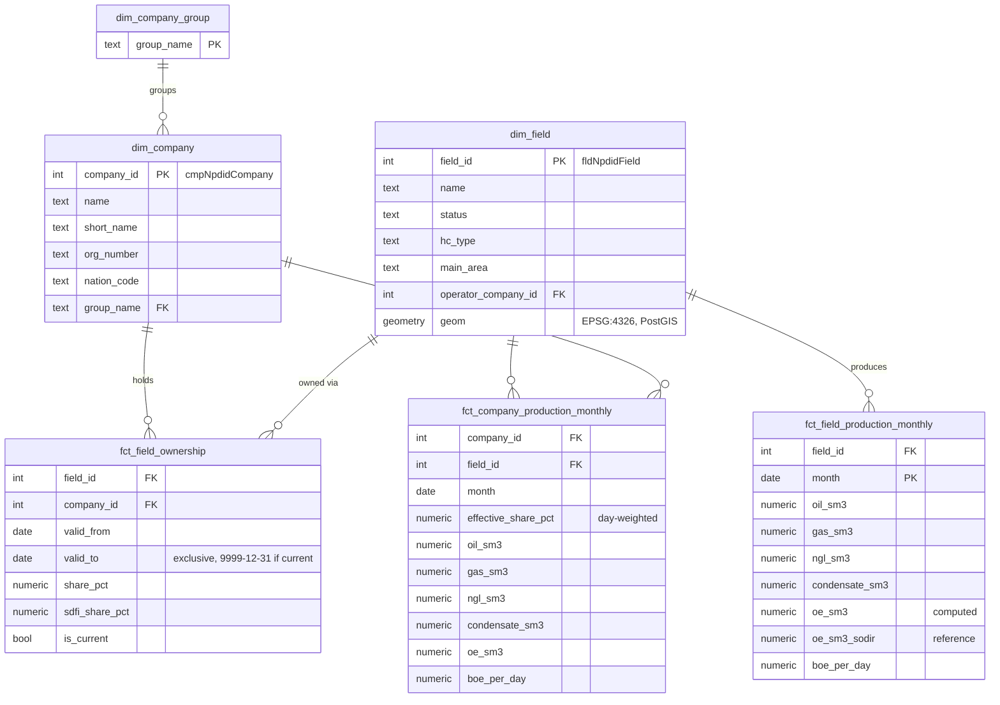

# Phase 1 plan: data sources, structure, data model, build steps

Status: **approved** (2026-11-08)

## 1. Sodir data sources (checked live on 2026-11-08)

Sodir's old FactPages CSV/XLS downloads are being phased out. The recommended way in is the
**DataService REST API**, an ArcGIS FeatureServer that exposes Sodir's tables directly.

Base URL:

```
https://factmaps.sodir.no/api/rest/services/DataService/Data/FeatureServer
```

| Id   | Table                  | Rows   | What we use it for                                                        |
|------|------------------------|--------|---------------------------------------------------------------------------|
| 7300 | `profiles`             | 32,434 | Production per field per month (1971 to Aug 2026) and per year            |
| 7100 | `field` (polygon)      | 142    | Field metadata: status, HC type, main area, operator, geometry            |
| 7108 | `field_licensee_hst`   | 10,088 | **Ownership share per field and company, with from/to dates**             |
| 7110 | `field_operator_hst`   | 580    | Operator history per field                                                |
| 7101 | `field_activity_status_hst` | –  | Status history (producing, shut down, ...)                               |
| 1200 | `company`              | 1,045  | Companies: name, org number, nation, `cmpGroup`                           |
| 3000 | `licence` (polygon)    | 1,813  | Production licences (context, map layer)                                  |
| 3007 | `licence_licensee_hst` | 33,372 | Licensee shares per licence over time (context, not used for attribution) |

How we query it:

- `.../{id}/query?where=1=1&outFields=*&f=json` with `resultOffset` / `resultRecordCount`
  for paging (`maxRecordCount` = 2000, `supportsPagination` = true)
- `returnCountOnly=true` gives the expected row count, which we use as an ingestion check
- Geometry is stored in ED50 (EPSG:4230); `outSR=4326&f=geojson` gives WGS84 for MapLibre
- Dates come as epoch milliseconds (UTC midnight)
- Licence: Norwegian Licence for Open Government Data (NLOD), so we must credit Sodir

### Things in the data that affect the design

1. **Production is in `profiles`**, not in a separate production table. `prfPeriod` is
   `month` or `year`, and `prfInformationCarrierKind` is `FIELD` or `DISCOVERY`. We use monthly FIELD rows.
2. **Units are mixed**: oil, NGL and condensate are in million Sm³; gas is in **billion** Sm³.
   Sodir also gives `prfPrdOeNetMillSm3` (oil equivalents), which we use as the reference
   to check our own oil-equivalent calculation in a dbt test.
3. **Net and gross both exist.** Net (saleable) is what companies report, so it is the default.
4. **Ownership is already history**: `field_licensee_hst` has `fldLicenseeFrom` / `fldLicenseeTo`,
   and the end date looks **inclusive** (e.g. one row ends 2022-06-29, the next starts 2022-06-30).
   Shares can change in the middle of a month.
5. **Ownership at field level vs licence level**: fields can cover several licences
   (unitised fields such as Johan Sverdrup). `field_licensee_hst` already gives the unitised
   field share, so we attribute production with it, not with licence shares.
6. **Companies are legal entities that merge and get renamed** (Lundin Energy Norway → Aker BP,
   Det norske → Aker BP). `company.cmpGroup` makes a group roll-up possible. That matters for
   the later Aker BP / Vår Energi nowcast.
7. **SDFI / Petoro**: the state's direct financial interest is a share like any other
   (`fldSdfiShare`). Shares per field per day should add up to 100% (we test that).
8. **Some field polygons are invalid** (found in step 1): 10 of 142 have self-intersecting
   rings after reprojection to WGS84. Staging repairs them with `ST_MakeValid`, and a dbt test
   checks that every geometry in marts is valid.
9. **Sodir revises history.** If we keep every raw snapshot, we can later answer
   "what did we know on date X?" That is needed so the nowcast backtest does not cheat.

## 2. Repository structure

```
pavement/                      # repo root (final name TBD)
├── pipeline/                  # Python package: Dagster + dbt
│   ├── src/<pkg>/
│   │   ├── sodir/             # typed ArcGIS client: paging, retries, schemas
│   │   ├── assets/            # Dagster assets: raw ingestion, dbt, checks
│   │   ├── resources.py       # Postgres + Sodir resources
│   │   └── definitions.py     # Dagster Definitions (assets, schedules, checks)
│   ├── dbt/
│   │   ├── models/staging/    # stg_sodir__*: typed, renamed, units fixed
│   │   ├── models/intermediate/
│   │   └── models/marts/      # dims + facts the API reads
│   ├── tests/                 # pytest, recorded Sodir responses (no network in CI)
│   └── pyproject.toml
├── api/                       # FastAPI, read-only on marts
│   ├── src/<pkg>_api/{routers,schemas,db.py,main.py}
│   ├── tests/
│   └── pyproject.toml
├── frontend/                  # React + TS strict + Vite
│   └── src/{api,components,pages}
├── infra/                     # Dockerfiles, Postgres init SQL
├── docs/                      # plans, ADRs, ERD
├── .github/workflows/ci.yml
├── docker-compose.yml
├── Makefile
├── .env.example
├── CLAUDE.md
└── README.md
```

Ready for later phases without building them now:

- `ml` schema placeholder in Postgres (forecasts, predictions with `predicted_at`)
- raw snapshots keyed by `ingestion_run_id` (needed for honest backtests)
- API routers split by domain, so `/forecasts` and `/ask` slot in later

## 3. Data model (ERD)



Layers in Postgres:

- `raw.sodir_<table>`: one row per record, `payload jsonb`, `ingestion_run_id`, `ingested_at`. Append only.
- `staging`: latest snapshot, typed columns, dates converted, units in Sm³ (gas × 10⁹, liquids × 10⁶).
- `marts`: the tables above. The API only reads from here.

Key formulas:

- `oe_sm3 = oil + condensate + ngl + gas / 1000`. Checked on real data (Johan Sverdrup,
  June 2022): 1.633746 oil + 0.059457 gas (bill Sm³ → mill Sm³ o.e.) + 0.034995 NGL + 0
  condensate = 1.728198, exactly Sodir's `prfPrdOeNetMillSm3`. The dbt test keeps checking it
- `boe_per_day = oe_sm3 × 6.2898 / days_in_month`
- `effective_share = Σ(share × days_valid_in_month) / days_in_month`
- attributed volume = field volume × effective share

dbt tests (plus the usual unique / not_null / relationships):

- no overlapping ownership intervals per (field, company)
- shares per field per day add up to 100% ± 0.01
- Σ attributed volume per field-month = field volume
- computed OE within 0.5% of Sodir's OE
- Dagster checks: row count = Sodir `returnCountOnly`; latest month is not older than 4 months

## 4. Build steps (each one ends with something that runs)

| # | Step | Verify |
|---|------|--------|
| 0 | Toolchain + repo bootstrap: own `git init`, `.gitignore`, `CLAUDE.md`, README skeleton, Makefile, `.env.example`, compose with PostGIS | `make up` → db healthy, `make psql` connects |
| 1 | Sodir client: typed paging + retries, writes to `raw.*`; pytest with recorded fixtures | `make ingest` loads 8 tables, counts match Sodir |
| 2 | Dagster: raw assets, monthly schedule, row-count + freshness checks | `dagster dev` shows graph, all assets materialise |
| 3 | dbt staging models + base tests | `dbt build` green |
| 4 | dbt marts: SCD2 ownership, field + company production, all tests above | `dbt build` green; Aker BP 2025 total is roughly in line with its annual report |
| 5 | dagster-dbt: dbt models as assets after raw | one click materialises everything |
| 6 | FastAPI: `/companies`, `/companies/{id}/production`, `/fields`, `/fields/{id}/production`, `/fields/{id}/ownership`, `/fields/geojson`, `/health` | `/docs` works, `curl` returns real data, pytest green |
| 7 | Frontend shell: company list, field production chart, MapLibre map; API types generated from OpenAPI | page shows real data from the API |
| 8 | GitHub Actions: ruff, eslint + tsc, pytest, dbt build on seeded Postgres, docker build | CI green on first PR |
| 9 | README: Mermaid architecture, setup, design decisions | fresh clone → `make up` works with no manual steps |

## 5. Decisions (2026-11-08)

1. Project name: **Stakeflow**
2. New public GitHub repo `stakeflow`
3. Production volumes: **net (saleable)**
4. PostGIS and Recharts approved
5. Toolchain via Homebrew, Docker Desktop

## 6. Constraints added 2026-11-08

1. **Equinor = "Equinor (NCS only)"** everywhere a company-level number appears. Implemented as
   a `display_name` column on `dim_company_group`, filled from a small dbt seed of label
   overrides, so the API and UI never build the label themselves. A dbt test fails if an
   Equinor group row lacks the "(NCS only)" suffix.
2. **No stock price prediction.** Share prices may be shown for context only.
3. **Nowcast feasibility** is in `docs/nowcast-feasibility.md`. Short version: companies publish
   production at T+12/14 and Sodir field data lands at T+40–69, so the nowcast is reframed as a
   forecast made at quarter end and scored against the trading update. Proposed additions to
   Phase 1: a daily "new month?" sensor in step 2 and `fct_publication_lag` in step 4.
