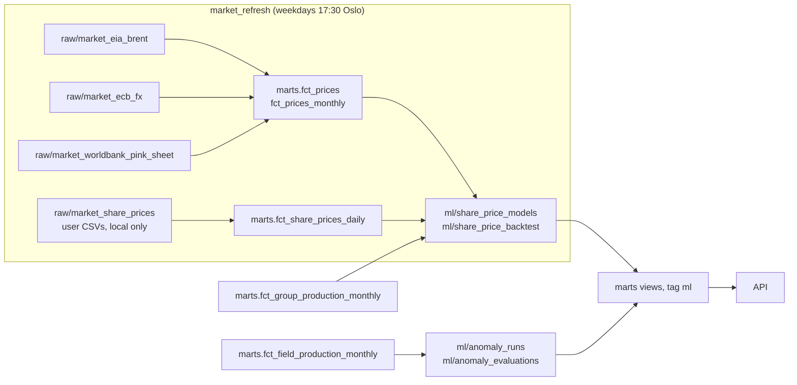

# Prices, scenario explorer and anomalies

How the market data, the anomaly feed and the share-price scenario model work, what the API
serves, and how it maps onto the frontend types. Sources and licences:
[market-data-sources.md](market-data-sources.md).

## Pipeline



- Market downloads run in their own job. The Sodir sensor and the monthly schedule run
  `sodir_refresh`, which is everything **except** the downloads, so a price API being down can
  never block or fail production data. Models that read prices refit from what is stored.
- Raw market tables are append-only like Sodir's: each run stores what the source returned for
  its window (full history from 2010 on the first load, then a look-back of 120 days for daily
  series and 2 years for the monthly workbook), and a run identical to the previous one is
  skipped. Staging keeps the newest value per (series, date). Runs live in
  `raw.market_ingestion_runs`, so they never count as a Sodir refresh.
- ML assets append a run to `ml.*`; dbt views in `models/marts_ml` (tag `ml`, a separate Dagster
  dbt group to avoid a cycle) show the latest run, so the API still reads only `marts`.
- dbt creates the raw market and `ml` tables on run start, so a database where nothing has been
  loaded yet builds empty marts instead of failing.

Commands without Dagster:

```bash
cd pipeline
uv run stakeflow-market                        # EIA, ECB, World Bank (or: stakeflow-market ecb_fx)
uv run stakeflow-import-share-prices ../data/share_prices
uv run dbt build --project-dir dbt --profiles-dir dbt
uv run stakeflow-ml                            # anomalies + scenario models (or one of them)
uv run stakeflow-load-market-fixtures tests/fixtures/market   # CI: recorded responses
```

Data tests: no gap longer than 7 days in daily series (the worst real gap is 6, over Easter
and Christmas) and 31 in monthly ones, unit labels, plausible ranges, unique keys, and EIA's
monthly average Brent against the World Bank's (0.7% apart on average; the largest gap, −21%
in April 2020, is the COVID crash when physical spot and dated Brent split).

## Anomalies

A month is an anomaly when a field's production is **more than 10% and more than 3 robust
sigmas** away from what its own history before that month suggests (no look-ahead):

- log boe/d, so a 10% drop means the same on a big and a small field;
- expected value: a Theil–Sen trend through the previous 12 producing months, extended one
  month. Fields decline, so a flat median would call every normal month a drop, and Theil–Sen
  ignores a few outage months;
- a seasonal variant (median residual per calendar month over 36 months) is used only where it
  forecast better out of sample;
- sigma: robust spread (MAD) of the field's real one-month-ahead forecast errors over the
  previous 24 months. Residuals around a fitted line understate real error: the first version
  used them and flagged about 30% of field-months;
- not judged: ramp-up (first 12 months), the last year of a field now shut down, fields expected
  below 1,000 boe/d, too little history;
- severity is the size of the miss: high from 10,000 boe/d, medium from 3,000, else low. A full
  outage of a 2,000 boe/d field matters less than −15% on Johan Sverdrup;
- the band [lo, hi] is exactly the range where a month is not flagged, so on the mini chart a
  point outside the band is a flagged month;
- impact per owner = (actual − expected) × today's share of the field, in kboe/d.

Latest run on the full Sodir history (2026-11-09): 90 fields judged over Sep 2024–Aug 2026,
1,820 judged field-months, **206 anomalies** (88 high, 75 medium, 43 low), about 11% of judged
field-months. Examples: Ormen Lange Aug 2026 −31% (97 vs 140 kboe/d expected; Petoro −15.7,
Equinor −10.9 kboe/d); Edvard Grieg, Ivar Aasen and Solveig together in May 2026 (−62%, −61%,
−70%; Aker BP −30.6 kboe/d across the three); Grane −89% and Snøhvit −28% the same month. The
feed states the numbers, not causes. Status (`new`, `investigating`, ...) is not stored yet:
every anomaly is `new`.

## Share-price scenario model

Not a forecast. Per focus company, ordinary least squares on monthly log returns:

    share = a + b_brent·Brent + b_ttf·TTF + b_production·production + b_eurusd·EUR/USD + e

- every regressor is a monthly log change of a monthly average (TTF only exists as one; the
  share uses the same averaging so both sides cover the same days); production is the
  company's Sodir-attributed boe/d;
- months where production jumps by more than 30% are left out: that is an acquisition, not a
  market signal (Aker BP + Lundin, July 2022);
- no market factor (no licensed free index; Equinor is a fifth of OSEBX, so it would be
  circular);
- stored per run: coefficients with standard errors and t-statistics, the full covariance
  matrix, R², adjusted R², residual standard deviation, window, n, excluded months, and each
  driver's typical monthly move.

A scenario applies the coefficients to the changes the user picks over h months. The
intercept (past drift) is not projected, so "everything flat" means a central change of 0%.
The 80% band combines coefficient uncertainty (x′ Cov(b) x) and the unexplained monthly noise
(h·s²), with a normal approximation. Caveats are attached when the sample is short, when a move
is far outside anything in the fitting window (more than 3 typical moves over the horizon),
when a used driver is not significant (|t| < 2), for Equinor (the share prices the whole group,
production here is NCS only), and when production −100% is floored at −99%.

**Backtest.** Each quarter is explained with what the drivers actually did, in sample and out
of sample (expanding window, fit on earlier months only, at least 12). It measures explanatory
power, not foresight. Out-of-sample R² and band coverage are only reported from 4 scored
quarters.

Verification on 2026-11-09 (shares Nov 2024–Nov 2026 from the free Euronext export, so
**n = 21 monthly returns**, Dec 2024–Aug 2026):

| Company | Brent b (SE) | TTF b (SE) | Production b (SE) | EUR/USD b (SE) | R² | adj. R² | resid. sd/month |
|---|---|---|---|---|---|---|---|
| Aker BP | 0.35 (0.08) | 0.08 (0.08) | −0.22 (0.13) | −0.29 (0.63) | 0.79 | 0.74 | 3.1% |
| Vår Energi | 0.42 (0.10) | 0.13 (0.10) | 0.12 (0.12) | −0.62 (0.77) | 0.78 | 0.73 | 3.9% |
| Equinor | 0.48 (0.08) | 0.19 (0.07) | 0.16 (0.13) | 0.18 (0.55) | 0.89 | 0.86 | 2.9% |

Brent is clearly significant for all three (t 4–6) and TTF for Equinor (t 2.6). Production and
EUR/USD are not distinguishable from zero. The high R² rests largely on one quarter (Q1 2026,
when the monthly average Brent went from 62 to 103 USD and the shares rose 32–53%). Only 2
quarters per company
could be scored out of sample, so no out-of-sample R² is reported; of those 6 company-quarters,
3 fell inside the 80% band (expected about 5), and the model trained on 13 months overshot
Aker BP's Q1 2026 (+79% explained vs +32% actual). Read the sensitivities as rough until a
longer share history is imported.

## API

| Endpoint | Returns | Frontend type |
|---|---|---|
| `GET /prices?series=&start=&end=` | `PriceSeries[]`: id, name, unit, frequency, source, sourceUrl, licence, attribution, points `{date, value}`. Default: last 365 days | `PriceSeries` (Brent and TTF only) |
| `GET /prices/latest` | newest spot values: `brentUsdPerBbl`, `ttfEurPerMwh`, `eurUsd`, `usdNok` with their dates, `kind: "spot"`, `asOf`. 503 before any load | `LatestPrices` |
| `GET /companies/{id}/share-price?start=&end=` | ticker, ISIN, exchange, currency, provenance note, points `{date, close, volume}`; empty when nothing was imported. 404 unknown or unlisted company | `SharePriceSeries` |
| `GET /companies/{id}/scenario?brent_change_pct=&ttf_change_pct=&production_change_pct=&eurusd_change_pct=&horizon_months=` | `changePct`, `price`, `band80`, `path`, `contributions`, `varianceFromCoefficients`, `model` (coefficients with SEs, R², window, n, backtest with note), `caveats`, `notice`. 422 outside the contract or unknown parameter, 404 unknown/unlisted company, 503 (with the reason) without a model | `ScenarioResult` with its `ScenarioModel` |
| `GET /scenarios/presets` | `{id, name, description, params}`, params in contract form | `ScenarioPreset` |
| `GET /anomalies?severity=&field_id=&company=&since=&limit=` | latest run, newest and largest first | `Anomaly` (exact field names) |
| `GET /anomalies/run` | run time, model version, window, counts, method text, parameters. 503 before any run | not used yet |

The scenario contract (shared with the free-text parser) is used with the same snake_case
names everywhere: query string, `scenario` echo in the response, and preset `params`:

```json
{"brent_change_pct": 0, "ttf_change_pct": 0, "production_change_pct": 0, "eurusd_change_pct": 0, "horizon_months": 3}
```

Ranges: Brent and TTF −90..+300, production −100..+100, EUR/USD −50..+100, horizon 1..24.

### How the frontend maps them

`frontend/src/api/extras.ts` turns each response into its frontend type (unit-tested in
`src/api/__tests__/extras.test.ts`); the static demo runs the same mappers over its exported
files, except share prices and scenarios, which are never exported.

- Only Brent and TTF are requested (`?series=brent&series=ttf`). TTF points are monthly (dated
  the 1st), so the landing page shows Brent daily over 3 months and TTF as monthly averages, and
  says so.
- There is no `/prices/forward`: `/prices/latest` is spot. The UI says "at latest prices" in
  every language and shows the date of each value.
- `Anomaly.operatorName` may be `null` and is then left out; `fieldName` is title-cased; `hits`
  lists every current owner, focus companies first. `status` is always `new` from the API; the
  reader's status changes and notes stay in the browser tab.
- Anomaly `expected`, `actual` and `series` are kboe/d as in the type; `pctVsExpected` is in
  percent.
- Scenario results are shown as the backend computed them (change, 80% band, price, each
  driver's contribution, caveats, notice); the intercept is past drift and is not shown with the
  sensitivities.
